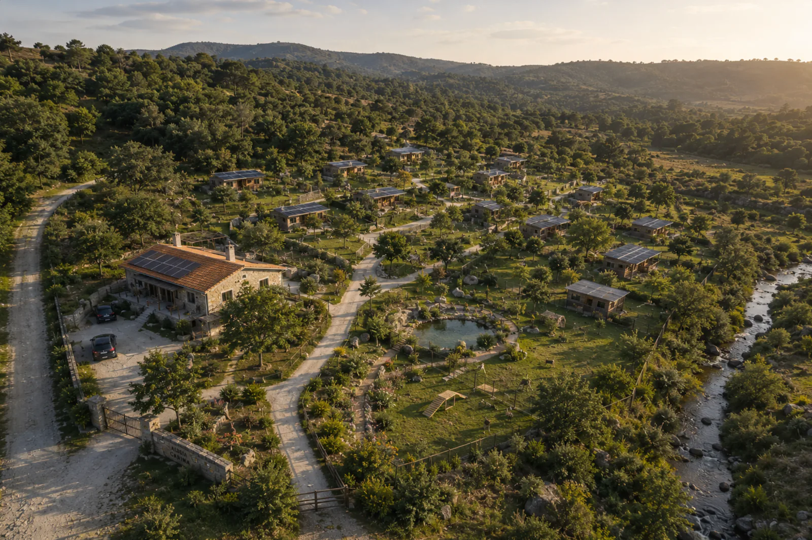
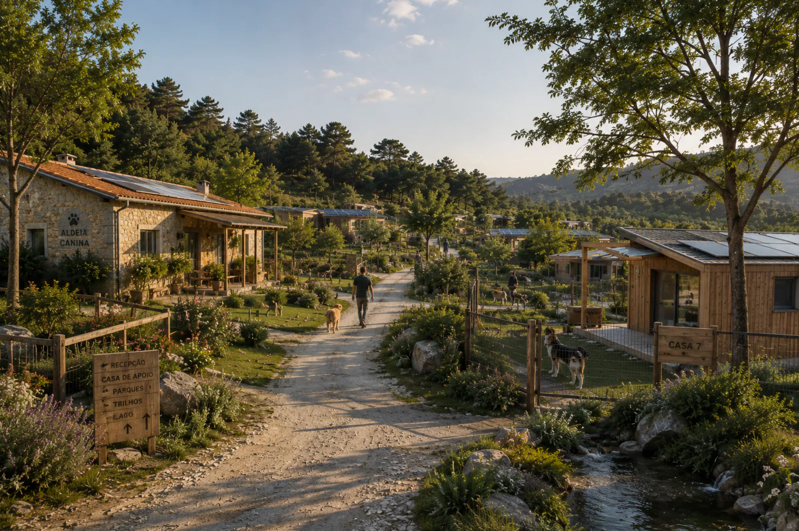

# Aldeia Canina Sustentável em Viseu

**Apresentação do projeto às entidades** 
**Versão:** 1.0 
**Data:** 3 de novembro de 2026 
**Base:** visão 2.0 do projeto, de 3 de novembro de 2026 
**Natureza:** documento conceptual; não é projeto de execução nem pedido formal; terreno ainda por escolher

## Como ler este documento

Este documento descreve o projeto no seu conjunto: o conceito, os serviços, os espaços, o funcionamento, as infraestruturas e os critérios de escolha do terreno. É comum a todas as entidades a que o projeto é apresentado e deve ser lido em primeiro lugar.

Cada entidade tem, além disso, um documento próprio, a ler a seguir a este, dedicado às matérias da sua área. As referências legais não são reproduzidas aqui; constam dos documentos de cada entidade.

| Entidade | Documento próprio |
| --- | --- |
| Câmara Municipal de Viseu | [`entidades/camara-municipal-viseu.md`](entidades/camara-municipal-viseu.md) |
| Gabinete Técnico Florestal | [`entidades/gabinete-tecnico-florestal.md`](entidades/gabinete-tecnico-florestal.md) |
| Direção-Geral de Alimentação e Veterinária (DGAV) | [`entidades/dgav.md`](entidades/dgav.md) |
| Instituto da Conservação da Natureza e das Florestas (ICNF) | [`entidades/icnf.md`](entidades/icnf.md) |
| Médico veterinário municipal | [`entidades/medico-veterinario-municipal.md`](entidades/medico-veterinario-municipal.md) |

Para uma leitura rápida, as secções 1, 3 e 10 resumem o conceito, os critérios de escolha do terreno e as condicionantes com as medidas previstas.

Conteúdo:

1. [O projeto](#1-o-projeto)
2. [Serviços previstos](#2-serviços-previstos)
3. [Terreno e critérios de seleção](#3-terreno-e-critérios-de-seleção)
4. [Espaços e componentes](#4-espaços-e-componentes)
5. [Bem-estar animal e funcionamento](#5-bem-estar-animal-e-funcionamento)
6. [Transporte de animais](#6-transporte-de-animais)
7. [Sustentabilidade e infraestruturas](#7-sustentabilidade-e-infraestruturas)
8. [Inovação e relação com os tutores](#8-inovação-e-relação-com-os-tutores)
9. [Impacto no território](#9-impacto-no-território)
10. [Condicionantes e medidas previstas](#10-condicionantes-e-medidas-previstas)
11. [Faseamento](#11-faseamento)
12. [Natureza e limites deste documento](#12-natureza-e-limites-deste-documento)

---

## 1. O projeto

O projeto prevê a criação de uma **aldeia canina sustentável em Viseu**, num terreno amplo ainda por escolher, com uma área de referência entre **15 000 e 25 000 m²** (ver [secção 3](#3-terreno-e-critérios-de-seleção)).

A aldeia afasta-se do modelo do canil tradicional e do hotel com boxes repetidas e um padrão único de alojamento. Organiza-se em **pequenas casas de alojamento animal**, independentes e de diferentes dimensões, distribuídas por zonas distintas do terreno e adaptadas ao porte, ao perfil, à rotina e às necessidades de cada animal. As casas agrupam-se em núcleos pouco densos ou pequenas ruas, ligados por caminhos e integrados na paisagem.

O projeto combina:

- alojamento animal com pernoita;
- creche diária / ATL canino;
- bem-estar animal individualizado;
- sustentabilidade ambiental;
- uma Casa de Apoio Operacional, preferencialmente por reabilitação de ruínas, quando existam e sejam viáveis;
- educação e treino canino;
- mobilidade animal inclusiva;
- digitalização da relação com os tutores;
- dinamização económica e social do território.

Em síntese, o projeto prevê uma aldeia canina sustentável, integrada na natureza, com casas de alojamento independentes, uma Casa de Apoio Operacional, creche diária / ATL canino, programas adaptados ao perfil de cada animal, soluções ambientais eficientes, transporte próprio e serviços complementares de treino, grooming, socialização e educação de tutores.

A aldeia cresce de forma modular e progressiva (ver [secção 11](#11-faseamento)).

_Figura 1 — Visualização conceptual da organização geral da aldeia. Não representa nenhum dos terrenos em estudo nem uma implantação ou projeto de execução._

---

## 2. Serviços previstos

| Serviço | Descrição |
| --- | --- |
| Alojamento com pernoita | Estadias curtas, médias ou prolongadas em casas de alojamento animal: alojamento individual, de cães da mesma família, de cães sénior, de cães ansiosos ou sensíveis e de cães com menor tolerância a grupos. |
| Creche diária / ATL canino | Permanência diurna, sem pernoita, em dia completo, meio dia, dias pontuais ou utilização regular, com avaliação prévia e grupos compatíveis. |
| Treino e educação canina | Aulas individuais e de grupo, socialização de cachorros, obediência básica, treino de cães adotados, sessões para cães reativos e aulas para famílias com crianças. |
| Grooming | Banho, tosquia, escovagem, corte de unhas, higiene básica e preparação pós-estadia. |
| Transporte de animais | Recolha e entrega para estadias, creche/ATL, grooming e aulas, em viatura adaptada (ver [secção 6](#6-transporte-de-animais)). |
| Workshops e eventos | Workshops para tutores, sessões sobre comportamento canino e cuidados básicos, e ações abertas à comunidade (ver [secção 9](#9-impacto-no-território)). |
| Gatil | Apenas como possibilidade futura, em edifício separado da área canina (ver [secção 4.9](#49-gatil)). |

Os serviços articulam-se entre si: a creche/ATL pode ser combinada com transporte, grooming e treino, e serve também de adaptação progressiva antes de uma primeira estadia.

---

## 3. Terreno e critérios de seleção

**Área de referência.** O projeto não depende de uma parcela concreta. Toma como referência um terreno com **15 000 a 25 000 m²**, sem forma topográfica obrigatória. Esta faixa é um pressuposto funcional do conceito, e não um mínimo legal nem uma dimensão fixada. A área necessária confirma-se, para cada terreno, através de um estudo prévio de implantação, em função da capacidade prevista, da área efetivamente utilizável, da topografia, dos acessos, da drenagem, da segurança, das condicionantes territoriais e da possibilidade de expansão.

A área deve permitir uma implantação pouco densa, com separação entre núcleos, zonas de atividade e de descanso, percursos, áreas verdes e infraestruturas operacionais.

**Terrenos em avaliação.** Estão em avaliação quatro terrenos, dois deles com ruínas. Este documento não identifica nem avalia nenhum deles.

**Adaptação do programa ao terreno.**

- As componentes do núcleo essencial (ver [secção 11](#11-faseamento)) são pensadas para caber em qualquer terreno da faixa de referência.
- A zona aquática, o gatil e os trilhos mais extensos dependem da área, da topografia e das condicionantes de cada terreno.
- A reabilitação de ruínas só se aplica se o terreno escolhido as tiver e se a sua estabilidade, o seu enquadramento urbanístico e a sua adequação funcional forem confirmados. Caso contrário, a Casa de Apoio Operacional resulta de construção nova ou do aproveitamento do edificado existente, se houver.

**Critérios do promotor.**

| Critério | Regra |
| --- | --- |
| Saneamento | **Eliminatório.** O terreno tem de permitir a ligação à rede pública de saneamento ou uma solução autónoma licenciável, dimensionada para a lotação máxima: dejetos, lavagens, grooming, lavandaria e picos de ocupação. |
| Perigosidade de incêndio rural | **Condicionante avaliada caso a caso.** Não se constrói nas áreas de perigosidade «muito alta» nem na sua envolvente, cuja distância está por definir. Um terreno com uma mancha destas não é excluído automaticamente: a decisão depende da dimensão do terreno face à mancha e à envolvente. |

Independentemente deste critério do promotor, a carta de perigosidade aplicável a cada terreno e as restrições legais à edificação em áreas de risco de incêndio, incluindo as que possam abranger outras classes de perigosidade, são confirmadas com as entidades competentes.

**Outros critérios avaliados em cada terreno candidato:**

- classificação do solo e usos admitidos no Plano Diretor Municipal (PDM);
- Estrutura Ecológica Municipal;
- Reserva Ecológica Nacional (REN) e Reserva Agrícola Nacional (RAN);
- linhas de água, zonas inundáveis e servidões;
- acessos normais e de emergência;
- abastecimento de água;
- distância a vizinhos e a outros recetores sensíveis ao ruído;
- drenagem, escorrências e pontos de acumulação de água;
- ruínas ou edificado existente e o respetivo enquadramento;
- exposição solar e sombra.

**Levantamento topográfico e pedido de informação prévia.** Para cada terreno candidato, o promotor considera aconselhável um levantamento topográfico antes de submeter o pedido de informação prévia (PIP) à Câmara Municipal. O levantamento permite estudar a implantação, a drenagem, os acessos e a área efetivamente utilizável. A modalidade do PIP e os elementos a apresentar confirmam-se com a Câmara Municipal.

**Aquisição.** Como boa prática, o promotor não pretende adquirir nem comprometer definitivamente nenhum terreno sem diligência técnica e jurídica e sem um PIP favorável e suficientemente detalhado, salvo alternativa de controlo expressamente validada para a operação concreta.

**Princípios de implantação.** O desenho segue o terreno, em vez de o contrariar com soluções demasiado artificiais:

- uso da topografia, quando houver variação de cotas, para separar zonas funcionais;
- casas de alojamento em zonas altas e secas; zonas mais baixas tratadas com especial atenção à drenagem;
- afastamento entre zonas ruidosas e zonas calmas;
- caminhos internos estabilizados, seguros e antiderrapantes;
- áreas de sombra natural e artificial;
- barreiras vegetais para conforto visual, ruído e vento;
- integração paisagística com vegetação autóctone e espécies adequadas ao local;
- circulação planeada para animais, equipa, tutores, viaturas, manutenção e emergência.

---

## 4. Espaços e componentes

A aldeia organiza-se nos espaços descritos nesta secção. A dimensão, o número e a localização de cada um dependem do terreno escolhido e do projeto técnico.

### 4.1 Casa de Apoio Operacional

A Casa de Apoio Operacional concentra a receção e as funções de apoio da aldeia. Se o terreno escolhido tiver ruínas cuja estabilidade, enquadramento urbanístico e adequação funcional sejam confirmados, resulta preferencialmente da sua reabilitação; caso contrário, resulta de construção nova ou do aproveitamento do edificado existente, se houver.

| Área | Componentes previstas |
| --- | --- |
| Receção e atendimento | Receção de tutores; check-in e check-out de estadias, creche/ATL e serviços complementares; validação documental; avaliação inicial; entrega e recolha dos animais; gabinete administrativo e espaço para reuniões; eventualmente, uma pequena loja de produtos. |
| Instalações da equipa | Instalações sanitárias, incluindo solução acessível; vestiários, duche e cacifos; pequena copa; sala de repouso temporário para permanências prolongadas ou situações operacionais excecionais. |
| Áreas operacionais e técnicas | Lavandaria com circuitos separados de material sujo e limpo; zona de preparação da alimentação animal; armazém de alimentação protegido de humidade, pragas e contaminação; armazém separado para produtos de limpeza e higienização; armazém independente para ferramentas, equipamentos e materiais de manutenção; zona de lavagem, secagem e recolha de material; arrumos para equipamento limpo; área técnica para sistemas elétricos, água, energia e monitorização; área controlada para separação e recolha de resíduos; espaço para registos operacionais. |

A sala de repouso é uma instalação de apoio à equipa e não se destina a habitação, alojamento turístico ou residência permanente.

Características previstas:

- acesso controlado, com dupla porta de segurança e zona de espera separada;
- separação entre circulação pública, áreas da equipa e circuitos operacionais;
- separação física entre alimentação, produtos de limpeza, manutenção e resíduos;
- boa sinalética e acesso fácil para a viatura de transporte de animais;
- acessibilidade e condições adequadas de ventilação, iluminação, saneamento e segurança contra incêndio;
- possibilidade de integração de painéis solares, quando técnica e economicamente viável.

### 4.2 Casas de alojamento animal

As casas de alojamento animal são o centro do projeto. São pequenas construções independentes ou integradas em núcleos pouco densos, de forma a evitar a imagem e a experiência de uma sequência de boxes. A arquitetura, os materiais, o afastamento entre casas e a relação com a paisagem reforçam o conceito de aldeia.

_Figura 2 — Visualização conceptual do ambiente pretendido. Não representa nenhum dos terrenos em estudo nem uma implantação ou projeto de execução._

**Tipologias previstas.**

| Tipo de casa | Utilização | Configuração e adaptações principais |
| --- | --- | --- |
| Casa S | 1 cão pequeno/médio | Quarto protegido, exterior privado e escala adaptada. |
| Casa M | 1 cão grande ou 2 pequenos | Maior área interior e exterior; ventilação e circulação reforçadas. |
| Casa Família | 2 a 4 cães da mesma família | Quartos comunicantes ou área conjunta, sem contacto com animais de outra família. |
| Casa Calma | Cães idosos ou sensíveis | Zona silenciosa, maior atenuação acústica e pavimento confortável. |
| Casa Individual | Cães que não podem conviver | Barreiras visuais, acessos próprios e maior controlo operacional. |

As casas podem ocupar diferentes cotas ou zonas do terreno, respeitando a topografia, o ruído, a sombra, os acessos e a drenagem. As casas destinadas a cães sénior, ansiosos ou sensíveis ficam em zonas mais tranquilas, e as destinadas a cães que não toleram bem a proximidade constante ficam mais afastadas.

**Quartos com espaço exterior privado.** Cada casa integra um ou mais quartos de alojamento, consoante a tipologia. Cada quarto tem uma área interior protegida e acesso direto a um espaço exterior privado, vedado e separado das restantes áreas da aldeia. O animal pode alternar entre repouso, observação e permanência no exterior, de acordo com a sua rotina e nas condições definidas pela equipa.

**Construção e conforto ambiental:**

- construção robusta e integrada na paisagem;
- isolamento térmico adequado ao clima local e atenuação acústica entre quartos, casas e zonas funcionais;
- ventilação e renovação de ar adequadas;
- iluminação natural controlada e iluminação artificial eficiente;
- pavimento confortável, antiderrapante, lavável e resistente ao uso intensivo;
- paredes, remates e materiais compatíveis com higienização frequente;
- proteção contra humidade, chuva, calor, frio e correntes de ar;
- monitorização de temperatura e humidade, quando aplicável.

**Organização de cada quarto:**

- área interior seca, protegida e confortável, com zona de repouso adequada ao perfil do animal;
- acesso permanente a água potável;
- pontos de alimentação concebidos para reduzir contaminação e competição;
- sombra e abrigo parcial no espaço exterior;
- barreiras visuais, quando o perfil comportamental do animal o exija;
- identificação clara de cada casa e quarto;
- dupla barreira, ou sistema equivalente, nos acessos;
- acesso operacional para limpeza, manutenção e emergência.

**Infraestruturas das casas.** Abastecimento de água e eletricidade; drenagem e encaminhamento adequado das águas residuais, com ligação à rede de saneamento ou solução autónoma estudada e licenciada; equipamentos instalados de forma a não criar riscos de mordedura, fuga, ferimento ou acesso indevido. A produção solar é uma possibilidade, não uma solução obrigatória, e pode ser individual, agrupada ou centralizada, consoante o estudo energético.

**Dimensões.** As dimensões das casas, dos quartos e dos espaços exteriores são definidas no projeto técnico. As instalações serão dimensionadas para respeitar as áreas mínimas legais aplicáveis ao alojamento de cães, entendidas como mínimos e não como dimensões de projeto, a confirmar com a DGAV e a validar com o médico veterinário responsável.

### 4.3 Parques exteriores por perfil

A aldeia não tem apenas um parque grande. Prevê áreas exteriores adaptadas a perfis diferentes:

- parque para cães pequenos;
- parque para cães grandes;
- parque ativo;
- parque calmo;
- parque individual;
- parque de adaptação;
- parque para cães sénior;
- parque para aulas.

A utilização dos parques segue horários e grupos de compatibilidade, alternados para reduzir conflitos.

### 4.4 Trilhos sensoriais e atividades de enriquecimento

**Trilhos sensoriais.** Percursos com estímulos controlados, compostos por relva, areia, madeira, pedra lisa, casca de pinheiro, plantas aromáticas seguras, pequenas rampas, túneis, plataformas, zonas de faro e pontos de pausa. Contribuem para a estimulação mental, a redução da ansiedade, a atividade física moderada e o enriquecimento ambiental.

**Atividades de enriquecimento ambiental.** Os animais não ficam apenas alojados. O projeto prevê:

- percursos de faro e zonas com diferentes texturas e cheiros;
- jogos cognitivos;
- zonas de escavação controlada;
- pequenas pontes, túneis baixos e plataformas de equilíbrio;
- agility leve;
- zonas de relaxamento;
- passeios orientados;
- atividades de enriquecimento ambiental supervisionadas, em grupos de compatibilidade;
- atividades individuais para cães que não convivem bem com outros.

As atividades ajustam-se à idade, ao porte, à energia e à condição física de cada animal e alternam com períodos de descanso: descanso, previsibilidade e pausas são tão importantes como o exercício. O mesmo exercício pode ser adequado para um cão jovem e inadequado para um cão sénior, braquicefálico, ansioso ou com limitações físicas.

Os materiais são seguros, laváveis e resistentes; túneis, rampas, plataformas e restantes equipamentos são inspecionados com regularidade; plantas e substratos são escolhidos por serem seguros para cães. As atividades são supervisionadas pela equipa, que regista as preferências e limitações de cada animal.

### 4.5 Creche diária e ATL canino

A creche diária / ATL canino é uma utilização diurna do espaço, sem alojamento noturno, para tutores que precisam de deixar o cão durante o dia. Articula-se com os parques exteriores, os trilhos sensoriais, as zonas de descanso e a avaliação comportamental.

Inclui:

- zona de receção e entrega rápida;
- áreas de permanência diurna;
- parques por grupo de compatibilidade;
- períodos de atividade e de descanso, com zonas de pausa para evitar excesso de excitação;
- horários de entrada, saída, atividade, descanso e alimentação;
- rotinas adaptadas ao perfil do cão;
- ligação a treino, grooming e transporte.

A creche/ATL tem lotação própria, ajustada à equipa disponível, critérios de admissão específicos, avaliação prévia e separação por porte, idade, energia, sociabilidade e forma de interagir com outros cães. Mantém registos de adaptação, incidentes e compatibilidades.

Nem todos os cães são bons candidatos a creche em grupo. Estão previstas atividades individuais, adaptação gradual ou recusa fundamentada quando a segurança ou o bem-estar do animal ou do grupo possam estar em causa.

### 4.6 Enfermaria e zona de isolamento

A enfermaria e a zona de isolamento/quarentena são instalações especializadas, separadas da circulação pública, da preparação de alimentos e das áreas comuns da equipa. Conforme validação técnica e veterinária, incluem:

- acesso controlado e, sempre que possível, independente;
- ventilação e materiais adequados à higienização;
- condições para observação temporária de animais;
- separação física e visual das casas de alojamento;
- ponto de água, drenagem e equipamentos próprios;
- armazenamento dedicado de material de utilização exclusiva;
- protocolos de entrada, saída, limpeza e gestão de resíduos;
- articulação com o médico veterinário, sem substituir cuidados clínicos externos quando necessários.

### 4.7 Grooming e treino

**Grooming.** Espaço para banho, tosquia, escovagem, corte de unhas, higiene básica e preparação pós-estadia. Pode integrar a fase de arranque ou ser uma componente complementar, a definir no desenvolvimento do projeto.

**Treino e educação canina.** Aulas individuais e de grupo, socialização de cachorros, obediência básica, treino de cães adotados, sessões para cães reativos, workshops para tutores e aulas para famílias com crianças. As aulas usam o parque próprio e os espaços para aulas, workshops e eventos.

### 4.8 Zona aquática

O projeto prevê, se o terreno escolhido o permitir, um **lago raso naturalizado**, concebido como zona aquática controlada e de acesso condicionado. A sua criação está sujeita a estudo técnico prévio (viabilidade, drenagem, impermeabilização, segurança e manutenção), a validação ambiental e ao licenciamento que se aplique.

Destina-se a enriquecimento ambiental, exercício supervisionado e conforto térmico dos animais em dias quentes, bem como à valorização paisagística do terreno. Não é uma zona de recreio livre ou permanente.

| Aspeto | Medidas previstas |
| --- | --- |
| Conceção | Profundidade reduzida e controlada; zonas rasas claramente delimitadas; margens seguras; rampas de entrada e saída em vários pontos; acessos antiderrapantes; vedação ou delimitação física; sombra nas zonas de espera; integração no plano geral de drenagem e gestão da água. |
| Utilização | Acesso apenas com supervisão da equipa; regras por porte, idade, condição física e perfil comportamental; grupos separados e horários próprios; avaliação individual prévia para cães idosos, pequenos, com problemas articulares, ansiosos, braquicefálicos ou com limitações físicas; zona seca alternativa para cães que não gostam de água ou não devem aceder ao lago. |
| Higiene e manutenção | Controlo regular da qualidade da água; plano de limpeza, filtragem e manutenção; prevenção de algas, odores, mosquitos e águas paradas; encerramento temporário sempre que as condições de segurança ou higiene não estejam reunidas. |
| Segurança | Prevenção dos riscos de fuga, queda, lama excessiva e contaminação cruzada entre animais. |

### 4.9 Gatil

O gatil é apenas uma possibilidade futura ou componente secundária e depende da área e das condicionantes do terreno. A existir, fica separado da área canina, num edifício afastado do ruído dos cães, com boa ventilação, luz natural, enriquecimento vertical, esconderijos, prateleiras, zonas individuais, controlo de odores, acesso controlado e baixa densidade.

---

## 5. Bem-estar animal e funcionamento

O projeto não aloja todos os cães da mesma forma: prevê respostas diferentes para animais com necessidades diferentes, numa abordagem de bem-estar animal individualizado.

**Avaliação inicial.** Antes de alojar ou receber um animal em creche/ATL, a equipa recolhe, pessoalmente ou através do portal do tutor, uma ficha de admissão obrigatória com:

- idade, porte e raça/tipo;
- estado vacinal e desparasitação;
- alimentação e medicação;
- histórico veterinário relevante e contacto do veterinário habitual;
- tipo de serviço previsto;
- comportamento com pessoas e com cães, reação a ruídos, à comida, à manipulação e à separação do tutor;
- medos, rotinas e necessidades especiais.

A admissão exige informação vacinal e sanitária adequada e segue critérios definidos de aceitação, recusa ou aceitação condicionada.

**Separação por perfil.** Os animais são agrupados e alojados segundo o porte, a idade, o nível de energia, a sociabilidade, a ansiedade, a reatividade, o estado de saúde, a experiência anterior de alojamento ou de creche/ATL e a pertença à mesma família. Os perfis considerados incluem cães sénior, ansiosos, reativos, tímidos, em primeira estadia, com medicação, com limitações físicas, com menor tolerância a grupos, muito ativos, pequenos, grandes e da mesma família.

O perfil serve para escolher a casa e o quarto mais adequados, os parques compatíveis, a integração na creche/ATL e a gestão da alimentação, da medicação e do descanso. Cada animal tem uma ficha individual, revista ao longo do tempo: o comportamento pode variar com a idade, a saúde e a experiência, e o perfil não funciona como rótulo permanente. A equipa terá formação em leitura comportamental básica e manterá registos de incidentes, alterações de comportamento e observações.

**Zona sénior e zona calma.** Área mais tranquila para cães idosos, com menor mobilidade, em medicação, que precisam de descanso prolongado, ansiosos, sensíveis ao ruído, em primeira estadia, pequenos ou frágeis. Prevê:

- afastamento das zonas de maior ruído e menor estímulo visual entre cães;
- pavimento confortável, antiderrapante e fácil de limpar;
- zonas de descanso com sombra;
- rotinas previsíveis de alimentação, passeio e descanso, com passeios curtos e adaptados;
- acompanhamento mais próximo, acesso rápido da equipa e procedimentos de medicação, observação e comunicação com tutores.

A zona sénior e calma é uma zona de bem-estar e acompanhamento adaptado. Não é uma enfermaria nem substitui hospitalização ou cuidados veterinários, e não mistura cães sénior frágeis com cães muito ativos.

**Rotinas adaptadas.** Cada cão tem um plano simples que abrange alimentação, descanso, passeio, atividades de enriquecimento, socialização, atividades de faro, períodos de descanso na creche/ATL, medicação e observações.

**Programa de Adaptação à Primeira Estadia.** Destina-se a reduzir a ansiedade e o risco de má adaptação, em cinco etapas:

1. visita inicial com o tutor;
2. meio dia de adaptação;
3. dia experimental;
4. primeira noite, se necessário;
5. relatório comportamental.

**Programa Cão Sénior.** Inclui zona calma, passeios curtos, pavimento confortável, alimentação acompanhada, medicação, descanso prolongado, menor exposição a grupos e relatório diário para o tutor.

**Articulação com o médico veterinário responsável.** As dimensões, os materiais, a ventilação, o isolamento térmico, o desempenho acústico, a drenagem, o saneamento e a higienização das instalações são validados com a equipa técnica e com o médico veterinário responsável, que intervém também nos protocolos de higiene e na conceção da enfermaria e da zona de isolamento. Em matéria de saúde animal, a equipa atua por observação, alerta, contacto com o tutor e articulação com médico veterinário quando necessário; a aldeia não substitui cuidados veterinários.

---

## 6. Transporte de animais

O projeto prevê um serviço próprio de transporte, em carrinha ou mini autocarro adaptado, para recolha e entrega de animais em contexto de estadia, creche/ATL, grooming, treino ou outros serviços. O serviço reduz barreiras de acesso, apoiando tutores sem transporte próprio, pessoas idosas ou com dificuldade de deslocação, famílias com horários difíceis e tutores que vivem em zonas afastadas.

**Utilizações:** recolha em casa do tutor, entrega após a estadia, transporte para creche/ATL, grooming e aulas de treino, rotas semanais ou em dias específicos e deslocações no âmbito de parcerias com médicos veterinários.

**Viatura:**

- adaptada ao transporte animal, com transportadoras ou compartimentos seguros;
- climatização e ventilação;
- limpeza fácil e protocolo de higienização entre utilizações;
- separação entre animais;
- kit de primeiros socorros e contactos de emergência;
- GPS e documentação de transporte;
- elétrica ou híbrida, se for viável.

**Funcionamento.** O transporte é uma operação controlada e registada. Prevê regras por porte, temperamento e saúde; animais incompatíveis não viajam em contacto direto; as autorizações de transporte e as recolhas e entregas ficam registadas; as rotas são organizadas para reduzir o stress e o tempo de viagem. Existem regras para atrasos, documentação, animais ansiosos, enjoos, fugas, acidentes e emergências.

---

## 7. Sustentabilidade e infraestruturas

A sustentabilidade ambiental é uma parte estrutural do projeto. O terreno amplo, a exposição solar, a necessidade de água, a drenagem, o saneamento e a utilização diária das instalações tornam-na especialmente relevante. As soluções finais dependem de estudo técnico e são proporcionais ao consumo previsto; o projeto não assume autonomia energética antes desse estudo.

| Área | Medidas previstas |
| --- | --- |
| Edificado existente | Reabilitação e reutilização de ruínas ou edificado existente, quando o terreno os tiver, após avaliação estrutural e confirmação do enquadramento urbanístico. |
| Energia | Painéis solares, com produção individual, agrupada ou centralizada; eventual micro-rede energética; baterias, quando fizerem sentido técnico; iluminação LED e sensores de presença; iluminação exterior eficiente; monitorização de consumos; carregamento para viatura elétrica ou híbrida. O dimensionamento parte dos consumos reais previstos. |
| Água | Recolha e armazenamento de águas pluviais em cisternas; rega gota a gota; espécies autóctones; redução do consumo de água potável em lavagens exteriores e na rega, quando legalmente permitido. |
| Saneamento | Ligação à rede pública ou solução autónoma licenciável, dimensionada para a lotação máxima (dejetos, lavagens, grooming, lavandaria e picos de ocupação). É critério eliminatório na escolha do terreno. |
| Solo e drenagem | Estudo de escoamento; proteção de taludes; caminhos estabilizados; valas drenantes; pavimentos permeáveis; bacias e zonas de retenção; drenagem natural; controlo de lama; vegetação para fixação do solo. Água, drenagem e saneamento são planeados em conjunto, sobretudo em terrenos com variação de cotas ou pontos de acumulação de água. |
| Materiais | Madeira certificada; cortiça; materiais reciclados, quando adequados; isolamento térmico eficiente; coberturas ventiladas; telhados verdes em zonas selecionadas; tintas e acabamentos de baixa toxicidade. Materiais duráveis, de baixa manutenção e resistentes à humidade, à limpeza e ao uso intensivo. |
| Resíduos | Separação de resíduos; redução de plásticos descartáveis; estações de recolha de dejetos; produtos de limpeza adequados; compostagem apenas de resíduos verdes, salvo validação técnica para outras opções; plano de higienização. |

O projeto evita soluções ambientais que sejam difíceis de limpar, manter ou licenciar.

---

## 8. Inovação e relação com os tutores

A inovação do projeto assenta no desenho modular da aldeia, em serviços ajustados ao perfil de cada animal e na digitalização da relação com os tutores.

**Portal digital do tutor.** O projeto prevê um portal digital para centralizar a informação, reduzir erros, facilitar reservas, melhorar a comunicação, guardar o histórico, reforçar a transparência e apoiar a gestão interna. Arranca com as funcionalidades essenciais:

- registo do tutor e do animal, com contactos de emergência;
- boletim de vacinas, ficha alimentar, medicação e preferências do animal;
- autorizações, incluindo recolha, transporte e imagem;
- reservas de estadias, creche/ATL e serviços;
- histórico de serviços.

Funcionalidades complementares ou futuras incluem relatórios diários, fotografias e vídeos curtos, check-in e check-out digital, alertas, recomendações pós-estadia e agenda de grooming e treino.

O portal terá acesso autenticado, dados organizados por tutor e por animal, permissões de visualização adequadas e registo de autorizações. Recolhe apenas os dados necessários, protege os dados pessoais e a informação sensível, define prazos de conservação e eliminação e prevê cópias de segurança e controlo de acessos. Articula-se com as reservas, a admissão e a comunicação diária, para simplificar a operação sem duplicar trabalho.

**Política de imagens e fotografias.** A partilha de fotografias e vídeos com os tutores segue uma política de imagens própria, assente no consentimento e na proteção de dados pessoais. A prioridade é o bem-estar animal e a rotina de cuidado, não a produção de conteúdo.

Uma eventual videovigilância das instalações é tratada separadamente da comunicação com os tutores e segue as regras de proteção de dados aplicáveis. Câmaras em direto para tutores não fazem parte da primeira fase; só poderão ser avaliadas no futuro, com enquadramento jurídico adequado.

---

## 9. Impacto no território

**Emprego local.** O projeto pode criar funções como tratadores e cuidadores, treinador canino, groomer, receção e administração, motorista e manutenção, e recorrer a apoio veterinário externo.

**Parcerias possíveis:** clínicas veterinárias, associações de proteção animal, escolas profissionais, juntas de freguesia, Câmara Municipal, fornecedores locais, treinadores, groomers e produtores locais de produtos para animais.

**Ações comunitárias possíveis:**

- dias de adoção responsável;
- workshops de cuidados básicos e de primeiros socorros para animais;
- sessões sobre comportamento canino;
- formação para famílias e sessões para crianças;
- ações de prevenção do abandono;
- caminhadas educativas;
- campanhas solidárias.

**Programa social.** Pode existir uma quota limitada e bem delimitada para situações especiais: apoio temporário a animais de pessoas hospitalizadas, apoio a tutores idosos, parcerias com associações, apoio em situações de emergência social e estadias solidárias mediante protocolo.

**Mobilidade inclusiva.** O serviço de transporte (ver [secção 6](#6-transporte-de-animais)) reduz barreiras territoriais e apoia pessoas sem transporte, pessoas idosas e tutores que pretendem usar a creche/ATL sem deslocação própria.

---

## 10. Condicionantes e medidas previstas

| Condicionante | Medidas previstas |
| --- | --- |
| Enquadramento urbanístico | Pré-enquadramento com a Câmara Municipal e técnicos; levantamento topográfico aconselhável e PIP antes de compromisso definitivo sobre o terreno, como boa prática, salvo alternativa de controlo expressamente validada para a operação concreta (ver secção 3). |
| Área útil do terreno | Estudo de implantação, topografia e condicionantes, porque a área do terreno pode não corresponder à área utilizável. |
| Condicionantes ambientais e territoriais | Estudo prévio de PDM, Estrutura Ecológica Municipal, REN, RAN, linhas de água e servidões; adaptação do layout. |
| Ruínas ou edificado existente | Levantamento, avaliação estrutural, confirmação do enquadramento urbanístico e licenciamento antes de definir a intervenção. |
| Perigosidade de incêndio rural | Avaliação caso a caso; implantação fora das áreas de perigosidade «muito alta» e da sua envolvente; plano de emergência, acessos e reservatório; confirmação das restrições legais com as entidades competentes. |
| Saneamento | Critério eliminatório; solução dimensionada para a lotação máxima e devidamente licenciada. |
| Drenagem | Levantamento topográfico e plano técnico de drenagem, porque os pontos baixos podem acumular água e lama. |
| Ruído | Atenuação acústica, orientação e afastamento das casas, barreiras vegetais, distância a recetores sensíveis e lotação controlada. |
| Contenção dos animais | Espaços exteriores vedados, dupla barreira nos acessos e equipamentos instalados sem riscos de fuga ou ferimento. |
| Higiene e saúde animal | Protocolos de higienização, acompanhamento do médico veterinário responsável e zona de isolamento. |
| Lotação | Crescimento progressivo e lotação controlada. |
| Zona aquática | Estudo técnico, validação ambiental e licenciamento prévios; acesso apenas supervisionado. |
| Transporte | Operação controlada e registada, com regras por perfil do animal e procedimentos de emergência. |
| Imagens e dados pessoais | Consentimento, partilha controlada e proteção de dados; câmaras em direto fora da primeira fase. |

---

## 11. Faseamento

O projeto prevê um crescimento modular e progressivo, a partir de um núcleo essencial e sem que a expansão comprometa o funcionamento da zona já existente. As componentes organizam-se por ordem de prioridade:

| Nível | Componentes |
| --- | --- |
| Núcleo essencial | Aldeia canina modular; casas de alojamento com quartos interiores e espaços exteriores privados; Casa de Apoio Operacional (por reabilitação de ruínas, quando existam e sejam viáveis); enfermaria e zona de isolamento; zonas por perfil comportamental; zona sénior e calma; plano de água, saneamento e drenagem. |
| Prioridade alta | Trilhos sensoriais; Programa de Adaptação à Primeira Estadia; creche diária / ATL canino; portal do tutor; partilha controlada de fotografias e vídeos; energia solar; viatura de transporte; treino. |
| Prioridade média | Zona aquática; grooming. |
| Complementares ou futuras | Gatil; câmaras em direto. |

O núcleo essencial é pensado para caber em qualquer terreno da faixa de referência. A zona aquática, o gatil e os trilhos mais extensos dependem do terreno escolhido. A composição e o calendário de cada fase definem-se no desenvolvimento do projeto.

---

## 12. Natureza e limites deste documento

- É um documento conceptual. Não é projeto de execução, estudo de implantação nem pedido formal de informação prévia, licenciamento ou autorização.
- É apresentado às entidades antes da escolha do terreno e do PIP, para recolher a sua orientação.
- O terreno ainda não foi escolhido. Nenhum dos terrenos em avaliação é identificado ou avaliado aqui.
- As figuras são visualizações conceptuais. Não representam nenhum dos terrenos em estudo, nem uma implantação, planta ou infraestrutura existente.
- Áreas, capacidades, dimensões e soluções técnicas confirmam-se no projeto técnico, com as entidades competentes e com o médico veterinário responsável.
- O documento não é parecer jurídico e não confirma a licenciabilidade nem a conformidade legal do projeto. O enquadramento legal de cada matéria consta dos documentos das entidades e depende das fontes oficiais e da validação das entidades competentes.
- A aldeia não substitui cuidados veterinários. As referências à saúde dos animais descrevem observação, acompanhamento e articulação com médico veterinário.
