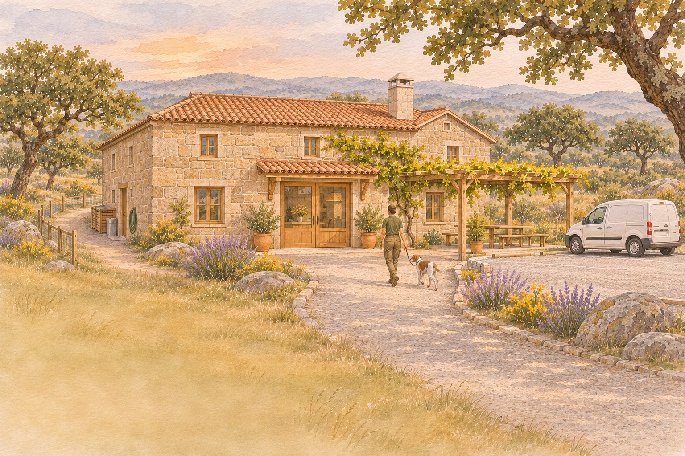
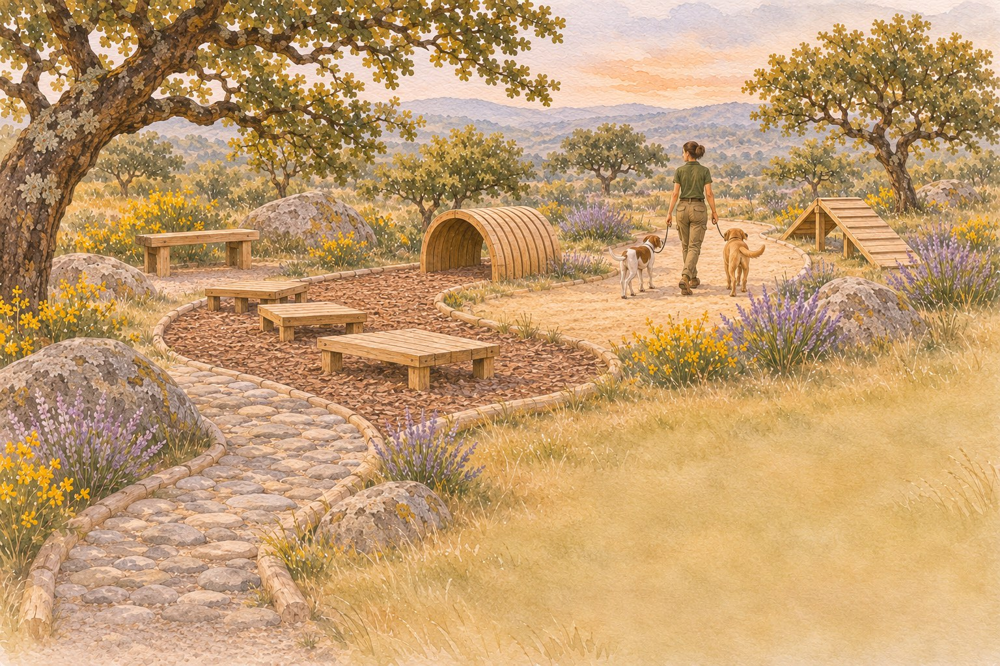
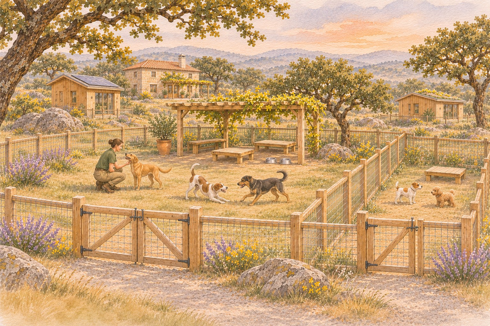
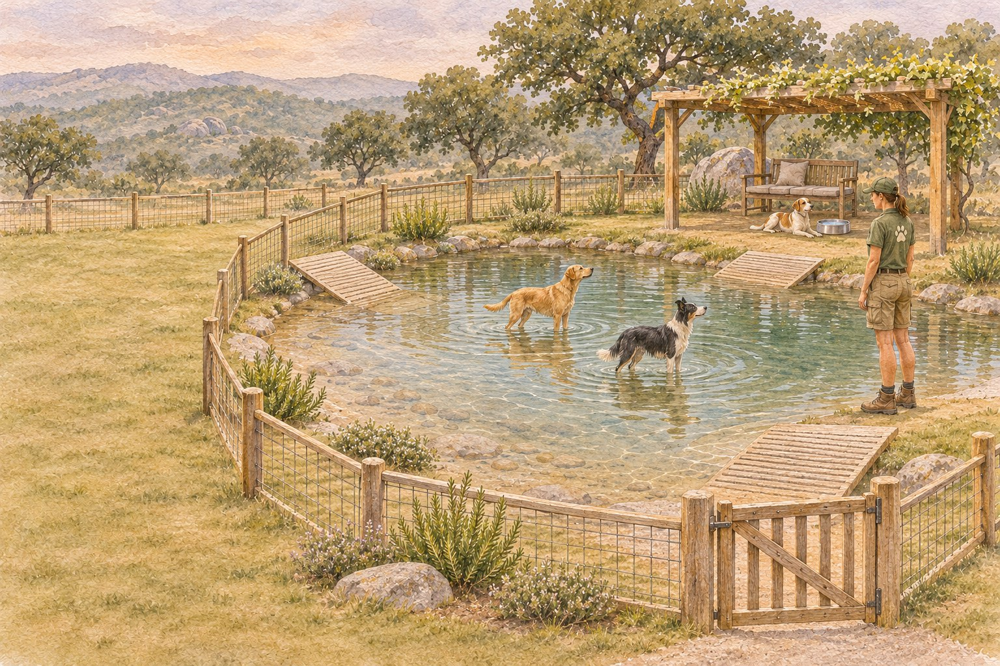

# Aldeia Canina Sustentável em Viseu

Apresentação do projeto às entidades. Versão 1.0, de 3 de novembro de 2026.

## Sobre este documento

Este documento preliminar apresenta o projeto antes de escolhermos o terreno; não é projeto de execução nem pedido formal.

Para cada entidade preparámos também um documento com os regimes que identificámos e as questões que gostaríamos de confirmar:

| Entidade | Documento próprio |
| --- | --- |
| Câmara Municipal de Viseu | [Pedido de orientação à Câmara Municipal de Viseu](entidades/camara-municipal-viseu.md) |
| Gabinete Técnico Florestal | [Pedido de orientação ao Gabinete Técnico Florestal](entidades/gabinete-tecnico-florestal.md) |
| Direção-Geral de Alimentação e Veterinária (DGAV) | [Pedido de orientação à Direção-Geral de Alimentação e Veterinária (DGAV)](entidades/dgav.md) |
| Instituto da Conservação da Natureza e das Florestas (ICNF) | [Pedido de orientação ao Instituto da Conservação da Natureza e das Florestas (ICNF)](entidades/icnf.md) |
| Médico veterinário municipal | [Pedido de orientação ao médico veterinário municipal](entidades/medico-veterinario-municipal.md) |

Conteúdo:

1. [O projeto](#1-o-projeto)
2. [Serviços previstos](#2-serviços-previstos)
3. [Terreno e critérios de seleção](#3-terreno-e-critérios-de-seleção)
4. [Espaços e componentes](#4-espaços-e-componentes)
5. [Bem-estar animal e funcionamento](#5-bem-estar-animal-e-funcionamento)
6. [Transporte de animais](#6-transporte-de-animais)
7. [Sustentabilidade e infraestruturas](#7-sustentabilidade-e-infraestruturas)
8. [Inovação e relação com os tutores](#8-inovação-e-relação-com-os-tutores)
9. [Impacto no território](#9-impacto-no-território)
10. [Condicionantes e medidas previstas](#10-condicionantes-e-medidas-previstas)
11. [Faseamento](#11-faseamento)
12. [Natureza e limites deste documento](#12-natureza-e-limites-deste-documento)

## 1. O projeto

Queremos criar uma aldeia canina sustentável em Viseu, num terreno amplo que ainda não escolhemos. Tomamos como referência uma área de 15 000 a 25 000 m² (ver [secção 3](#3-terreno-e-critérios-de-seleção)).

A aldeia é feita de pequenas casas de alojamento animal, independentes e de várias dimensões, distribuídas por diferentes zonas do terreno e adaptadas ao porte, ao perfil, à rotina e às necessidades de cada animal. As casas juntam-se em núcleos pouco densos ou em pequenas ruas, ligados por caminhos e integrados na paisagem. Afastamo-nos do canil tradicional e do hotel de boxes repetidas, em que todos os animais têm o mesmo tipo de alojamento.

Os serviços vão do alojamento com pernoita à creche diária/ATL canino, com transporte próprio e serviços complementares de treino e educação canina, grooming, socialização e educação de tutores. O bem-estar de cada animal é acompanhado individualmente, com programas ajustados ao seu perfil. Para apoio à operação haverá uma Casa de Apoio Operacional, de preferência em ruínas reabilitadas, se o terreno as tiver e forem viáveis.

Para a sustentabilidade ambiental, procuramos soluções eficientes (ver [secção 7](#7-sustentabilidade-e-infraestruturas)). O transporte serve também quem tem dificuldade em deslocar-se, a relação com os tutores apoia-se num portal digital (ver [secção 8](#8-inovação-e-relação-com-os-tutores)) e queremos que a aldeia tenha impacto económico e social no território. Crescerá por módulos, de forma progressiva (ver [secção 11](#11-faseamento)).

_Figura 1. Visualização ilustrativa da organização geral da aldeia._

## 2. Serviços previstos

| Serviço | Descrição |
| --- | --- |
| Alojamento com pernoita | Estadias curtas, médias ou prolongadas nas casas de alojamento animal. Há alojamento individual e para cães da mesma família, cães sénior, cães ansiosos ou sensíveis e cães com menor tolerância a grupos. |
| Creche diária/ATL canino | Permanência diurna, sem pernoita, em dia completo, meio dia, dias pontuais ou utilização regular, com avaliação prévia e grupos compatíveis. |
| Treino e educação canina | Aulas individuais e de grupo, socialização de cachorros, obediência básica, treino de cães adotados, sessões para cães reativos e aulas para famílias com crianças. |
| Grooming | Banho, tosquia, escovagem, corte de unhas, higiene básica e preparação pós-estadia. |
| Transporte de animais | Recolha e entrega para estadias, creche/ATL, grooming e aulas, em viatura adaptada (ver [secção 6](#6-transporte-de-animais)). |
| Workshops e eventos | Workshops para tutores, sessões sobre comportamento canino e cuidados básicos, e ações abertas à comunidade (ver [secção 9](#9-impacto-no-território)). |
| Gatil | Só como possibilidade futura, num edifício separado da área canina (ver [secção 4.9](#49-gatil)). |

Os serviços combinam-se entre si. A creche/ATL, por exemplo, pode juntar-se ao transporte, ao grooming e ao treino, e serve também de adaptação progressiva antes de uma primeira estadia.

## 3. Terreno e critérios de seleção

O projeto não depende de uma parcela concreta. Tomamos como referência um terreno com 15 000 a 25 000 m², sem forma topográfica obrigatória. Esta faixa é um pressuposto funcional do conceito, e não um mínimo legal nem uma dimensão fixada. Para cada terreno, a área necessária confirma-se num estudo prévio de implantação. O estudo tem em conta a capacidade prevista, a área que se pode realmente usar, a topografia, os acessos, a drenagem, a segurança, as condicionantes territoriais e a possibilidade de expansão.

A área deve permitir uma implantação pouco densa, com separação entre núcleos, zonas de atividade e de descanso, percursos, áreas verdes e infraestruturas operacionais.

Estamos a avaliar quatro terrenos, dois deles com ruínas. Não os identificamos nem avaliamos neste documento.

As componentes do núcleo essencial (ver [secção 11](#11-faseamento)) foram pensadas para caber em qualquer terreno dentro da faixa de referência. A zona aquática, o gatil e os trilhos mais extensos dependem da área, da topografia e das condicionantes de cada terreno. Só reabilitamos ruínas se o terreno escolhido as tiver e se a sua estabilidade, o seu enquadramento urbanístico e a sua adequação funcional forem confirmados. Se não for esse o caso, a Casa de Apoio Operacional será construção nova ou aproveitará o edificado existente, se houver.

Na escolha do terreno aplicamos dois critérios nossos:

| Critério | Como o aplicamos |
| --- | --- |
| Saneamento | Eliminatório. O terreno tem de permitir a ligação à rede pública de saneamento ou uma solução autónoma licenciável, dimensionada para a lotação máxima e para os dejetos, as lavagens, o grooming, a lavandaria e os picos de ocupação. |
| Perigosidade de incêndio rural | Condicionante, avaliada caso a caso. Não construímos nas áreas de perigosidade «muito alta» nem na sua envolvente, cuja distância ainda está por definir. |

Um terreno com uma mancha de perigosidade «muito alta» não fica automaticamente excluído. A decisão depende da dimensão do terreno face à mancha e à envolvente. O critério de perigosidade não substitui a confirmação, junto das entidades competentes, da carta de perigosidade que se aplica a cada terreno e das restrições legais à edificação em áreas de risco de incêndio, incluindo as que se apliquem a outras classes de perigosidade.

Em cada terreno candidato avaliamos também:

- a classificação do solo e os usos admitidos no Plano Diretor Municipal (PDM);
- a Estrutura Ecológica Municipal;
- a Reserva Ecológica Nacional (REN) e a Reserva Agrícola Nacional (RAN);
- as linhas de água, as zonas inundáveis e as servidões;
- os acessos normais e de emergência;
- o abastecimento de água;
- a distância a vizinhos e a outros recetores sensíveis ao ruído;
- a drenagem, as escorrências e os pontos de acumulação de água;
- as ruínas ou o edificado existente e o respetivo enquadramento;
- a exposição solar e a sombra.

Para cada terreno candidato, consideramos aconselhável fazer um levantamento topográfico antes de submeter o pedido de informação prévia (PIP) à Câmara Municipal. Com ele podemos estudar a implantação, a drenagem, os acessos e a área que se pode realmente usar. Vamos confirmar com a Câmara Municipal a modalidade do PIP e os elementos a apresentar.

Como boa prática, não pretendemos adquirir nem comprometer definitivamente nenhum terreno sem diligência técnica e jurídica e sem um PIP favorável e suficientemente detalhado, salvo alternativa de controlo expressamente validada para a operação concreta.

Na implantação, o desenho acompanha o terreno e evita soluções demasiado artificiais. Onde houver variação de cotas, usamo-la para separar zonas funcionais. As casas de alojamento ficam nas zonas altas e secas, e as zonas mais baixas recebem especial atenção à drenagem. As zonas ruidosas ficam afastadas das calmas. Os caminhos internos são estabilizados, seguros e antiderrapantes, e há áreas de sombra natural e artificial. Usamos barreiras vegetais pensadas para o conforto visual, o ruído e o vento, e a vegetação autóctone e as espécies adequadas ao local integram a aldeia na paisagem. A circulação é planeada para animais, equipa, tutores, viaturas, manutenção e emergência.

## 4. Espaços e componentes

### 4.1 Casa de Apoio Operacional

Na Casa de Apoio Operacional ficam a receção e as funções de apoio da aldeia. A casa resulta de preferência da reabilitação de uma ruína, nas condições descritas na [secção 3](#3-terreno-e-critérios-de-seleção).

_Figura 2. Visualização ilustrativa da Casa de Apoio Operacional._

Na receção atendemos os tutores e fazemos o check-in e o check-out das estadias, da creche/ATL e dos serviços complementares, a validação documental, a avaliação inicial e a entrega e recolha dos animais. Há também um gabinete administrativo, um espaço para reuniões e, eventualmente, uma pequena loja de produtos.

Para a equipa há instalações sanitárias, incluindo uma solução acessível, vestiários, duche e cacifos, uma pequena copa e uma sala de repouso temporário, para permanências prolongadas ou situações operacionais excecionais. A sala de repouso serve de apoio à equipa e não se destina a habitação, alojamento turístico nem residência permanente.

As áreas operacionais e técnicas incluem a lavandaria, com circuitos separados para o material sujo e o limpo, e a zona de preparação da alimentação animal. Há três armazéns distintos: um para a alimentação, protegido de humidade, pragas e contaminação, outro para produtos de limpeza e higienização e outro para ferramentas, equipamentos e materiais de manutenção. Há também uma zona de lavagem, secagem e recolha de material e arrumos para equipamento limpo. Completam o conjunto uma área técnica para os sistemas elétricos, a água, a energia e a monitorização, uma área controlada para separar e recolher resíduos e um espaço para registos operacionais.

O acesso é controlado, com dupla porta de segurança e uma zona de espera separada. A circulação pública fica separada das áreas da equipa e dos circuitos operacionais, e a alimentação, os produtos de limpeza, a manutenção e os resíduos ficam fisicamente separados entre si. O edifício terá boa sinalética, acesso fácil para a viatura de transporte de animais, acessibilidade e condições adequadas de ventilação, iluminação, saneamento e segurança contra incêndio. Pode ter painéis solares, quando for técnica e economicamente viável.

### 4.2 Casas de alojamento animal

O projeto gira à volta das casas de alojamento animal: pequenas construções independentes ou agrupadas em núcleos pouco densos, para que nem a imagem nem a experiência sejam as de uma sequência de boxes. A arquitetura, os materiais, o afastamento entre as casas e a relação com a paisagem dão forma à ideia de aldeia.

_Figura 3. Visualização ilustrativa do ambiente pretendido._

Prevemos cinco tipologias de casa:

| Tipo de casa | Utilização | Configuração e adaptações principais |
| --- | --- | --- |
| Casa S | 1 cão pequeno/médio | Quarto protegido, exterior privado e escala adaptada. |
| Casa M | 1 cão grande ou 2 pequenos | Maior área interior e exterior; ventilação e circulação reforçadas. |
| Casa Família | 2 a 4 cães da mesma família | Quartos comunicantes ou área conjunta, sem contacto com animais de outra família. |
| Casa Calma | Cães idosos ou sensíveis | Zona silenciosa, maior atenuação acústica e pavimento confortável. |
| Casa Individual | Cães que não podem conviver | Barreiras visuais, acessos próprios e maior controlo operacional. |

As casas podem ficar a cotas ou em zonas diferentes do terreno, consoante a topografia, o ruído, a sombra, os acessos e a drenagem. As dos cães sénior, ansiosos ou sensíveis ficam nas zonas mais tranquilas, e as dos cães que não toleram bem a proximidade constante ficam mais afastadas.

Cada casa tem um ou mais quartos de alojamento, conforme a tipologia. Cada quarto tem uma área interior protegida e acesso direto a um espaço exterior privado, vedado e separado das restantes áreas da aldeia. O animal pode alternar entre o repouso, a observação e a permanência no exterior, de acordo com a sua rotina e nas condições definidas pela equipa.

A construção tem de ser resistente e enquadrar-se na paisagem, com isolamento térmico ajustado ao clima local, atenuação acústica entre quartos, casas e zonas funcionais, ventilação e renovação de ar adequadas, iluminação natural controlada e iluminação artificial eficiente. O pavimento é confortável, antiderrapante, lavável e resistente ao uso intensivo, e as paredes, os remates e os materiais são compatíveis com higienização frequente. As casas protegem da humidade, da chuva, do calor, do frio e das correntes de ar e, quando aplicável, têm monitorização de temperatura e humidade.

Cada quarto inclui:

- área interior seca, protegida e confortável, com zona de repouso adequada ao perfil do animal;
- acesso permanente a água potável;
- pontos de alimentação concebidos para reduzir contaminação e competição;
- sombra e abrigo parcial no espaço exterior;
- barreiras visuais, quando o perfil comportamental do animal o exija;
- identificação clara de cada casa e quarto;
- dupla barreira, ou sistema equivalente, nos acessos;
- acesso operacional para limpeza, manutenção e emergência.

As casas têm abastecimento de água e eletricidade, drenagem e encaminhamento adequado das águas residuais, com ligação à rede de saneamento ou a uma solução autónoma estudada e licenciada. Os equipamentos são instalados de forma a não criar riscos de mordedura, fuga, ferimento ou acesso indevido. A produção solar é opcional e, a existir, pode ser individual, agrupada ou centralizada, consoante o estudo energético.

As dimensões das casas, dos quartos e dos espaços exteriores ficam definidas no projeto técnico. Vamos dimensionar as instalações para respeitar as áreas mínimas legais aplicáveis ao alojamento de cães. Tomamo-las como mínimos, não como dimensões de projeto, e vamos confirmá-las com a DGAV e validá-las com o médico veterinário responsável.

### 4.3 Parques exteriores por perfil

As áreas exteriores dividem-se por perfil. Há parques para cães pequenos, para cães grandes e para cães sénior, um parque ativo e um parque calmo, um parque individual, um parque de adaptação e um parque para aulas. Os parques usam-se por horários e por grupos de compatibilidade, alternados para reduzir conflitos.

_Figura 4. Visualização ilustrativa dos parques exteriores por perfil._

### 4.4 Trilhos sensoriais e atividades de enriquecimento

Os trilhos sensoriais juntam superfícies diferentes (relva, areia, madeira, pedra lisa e casca de pinheiro), plantas aromáticas seguras, equipamentos (pequenas rampas, túneis e plataformas), zonas de faro e pontos de pausa, em percursos com estímulos controlados. Contribuem para estimular mentalmente os animais, reduzir a ansiedade e dar-lhes atividade física moderada e enriquecimento ambiental.

_Figura 5. Visualização ilustrativa de um trilho sensorial._

Além dos trilhos, há atividades de enriquecimento ambiental: percursos de faro e zonas com texturas e cheiros diferentes, jogos cognitivos, zonas de escavação controlada, pequenas pontes, túneis baixos e plataformas de equilíbrio, agility leve, zonas de relaxamento e passeios orientados. As atividades são supervisionadas pela equipa. As de grupo fazem-se em grupos de compatibilidade, e para os cães que não convivem bem com outros há atividades individuais.

As atividades ajustam-se à idade, ao porte, à energia e à condição física de cada animal e alternam com períodos de descanso.

Os materiais são seguros, laváveis e resistentes. Os túneis, as rampas, as plataformas e os restantes equipamentos são inspecionados com regularidade, e as plantas e os substratos escolhem-se por serem seguros para cães. A equipa regista as preferências e as limitações de cada animal.

### 4.5 Creche diária e ATL canino

A creche/ATL usa os parques exteriores, os trilhos sensoriais e as zonas de descanso, e apoia-se na avaliação comportamental.

_Figura 6. Visualização ilustrativa da creche diária e dos parques por grupo._

Tem uma zona de receção e entrega rápida, áreas de permanência diurna e parques por grupo de compatibilidade. O dia segue horários de entrada, saída, atividade, descanso e alimentação, e há zonas de pausa para evitar o excesso de excitação. As rotinas adaptam-se ao perfil do cão, e a creche liga-se ao treino, ao grooming e ao transporte.

A creche/ATL tem lotação própria, ajustada à equipa disponível, e critérios de admissão específicos, com avaliação prévia. Os cães separam-se por porte, idade, energia, sociabilidade e forma de interagir com outros cães, e ficam registadas a adaptação, os incidentes e as compatibilidades.

Quando a segurança ou o bem-estar do animal ou do grupo possam estar em causa, a resposta pode ser uma atividade individual, uma adaptação gradual ou uma recusa fundamentada.

### 4.6 Enfermaria e zona de isolamento

A enfermaria e a zona de isolamento/quarentena ficam separadas da circulação pública, da preparação de alimentos e das áreas comuns da equipa. Conforme a validação técnica e veterinária, incluem:

- acesso controlado e, sempre que possível, independente;
- ventilação e materiais adequados à higienização;
- condições para observação temporária de animais;
- separação física e visual das casas de alojamento;
- ponto de água, drenagem e equipamentos próprios;
- armazenamento dedicado de material de utilização exclusiva;
- protocolos de entrada, saída, limpeza e gestão de resíduos;
- articulação com o médico veterinário, sem substituir cuidados clínicos externos quando necessários.

_Figura 7. Visualização ilustrativa da enfermaria e da zona de isolamento._

### 4.7 Grooming e treino

Há um espaço para os serviços de grooming descritos na [secção 2](#2-serviços-previstos). Pode entrar na fase de arranque ou ficar como componente complementar, o que se decide no desenvolvimento do projeto.

O treino e a educação canina (ver [secção 2](#2-serviços-previstos)), incluindo os workshops para tutores, usam o parque próprio e os espaços para aulas, workshops e eventos.

_Figura 8. Visualização ilustrativa do espaço de grooming e do parque de treino._

### 4.8 Zona aquática

Se o terreno escolhido o permitir, prevemos um lago raso naturalizado, pensado como zona aquática controlada e de acesso condicionado. A sua criação depende de um estudo técnico prévio (viabilidade, drenagem, impermeabilização, segurança e manutenção), de validação ambiental e do licenciamento que se aplique.

_Figura 9. Visualização ilustrativa da zona aquática._

O lago serve o enriquecimento ambiental, o exercício supervisionado e o conforto térmico dos animais nos dias quentes. Não é uma zona de recreio livre nem permanente.

Tem profundidade reduzida e controlada, zonas rasas claramente delimitadas e margens seguras, com rampas de entrada e saída em vários pontos e acessos antiderrapantes. Tem também vedação ou delimitação física e sombra nas zonas de espera, e entra no plano geral de drenagem e gestão da água.

Só se acede ao lago com supervisão da equipa, segundo regras por porte, idade, condição física e perfil comportamental, em grupos separados e com horários próprios. Os cães idosos, pequenos, com problemas articulares, ansiosos, braquicefálicos ou com limitações físicas têm avaliação individual prévia, e há uma zona seca alternativa para os cães que não gostam de água ou não devem aceder ao lago.

A qualidade da água é controlada com regularidade e há um plano de limpeza, filtragem e manutenção, com prevenção de algas, odores, mosquitos e águas paradas. O lago fecha temporariamente sempre que as condições de segurança ou de higiene não estejam reunidas. Previnem-se também os riscos de fuga, queda, lama excessiva e contaminação cruzada entre animais.

### 4.9 Gatil

O gatil é só uma possibilidade futura ou uma componente secundária, e depende da área e das condicionantes do terreno. A existir, fica separado da área canina, num edifício afastado do ruído dos cães. Tem boa ventilação, luz natural, enriquecimento vertical, esconderijos, prateleiras, zonas individuais, controlo de odores, acesso controlado e baixa densidade.

_Figura 10. Visualização ilustrativa de um possível gatil._

## 5. Bem-estar animal e funcionamento

A forma de alojar e de cuidar de cada cão depende das suas necessidades, e o bem-estar é pensado animal a animal.

Antes de alojar um animal ou de o receber na creche/ATL, a equipa recolhe, pessoalmente ou através do portal do tutor, uma ficha de admissão obrigatória com:

- idade, porte e raça/tipo;
- estado vacinal e desparasitação;
- alimentação e medicação;
- histórico veterinário relevante e contacto do veterinário habitual;
- tipo de serviço previsto;
- comportamento com pessoas e com cães, reação a ruídos, à comida, à manipulação e à separação do tutor;
- medos, rotinas e necessidades especiais.

A admissão exige informação vacinal e sanitária adequada e segue critérios definidos de aceitação, recusa ou aceitação condicionada.

Os animais agrupam-se e alojam-se segundo o porte, a idade, o estado de saúde, o perfil comportamental (nível de energia, sociabilidade, ansiedade e reatividade), a experiência anterior de alojamento ou de creche/ATL e a pertença à mesma família. Entre os perfis que consideramos estão cães pequenos, grandes ou sénior; cães muito ativos, ansiosos, reativos, tímidos ou com menor tolerância a grupos; cães com medicação ou com limitações físicas; e cães em primeira estadia ou da mesma família.

O perfil serve para escolher a casa e o quarto mais adequados, os parques compatíveis e a integração na creche/ATL, e para gerir a alimentação, a medicação e o descanso. Cada animal tem uma ficha individual que vai sendo revista; o perfil não funciona como rótulo permanente. A equipa terá formação em leitura comportamental básica e manterá registos de incidentes, alterações de comportamento e observações.

Há uma zona sénior e calma, mais tranquila, para cães idosos, com menor mobilidade, em medicação, que precisam de descanso prolongado, ansiosos, sensíveis ao ruído, em primeira estadia, pequenos ou frágeis. Fica afastada das zonas de maior ruído, com menos estímulo visual entre cães, pavimento confortável, antiderrapante e fácil de limpar e zonas de descanso com sombra. As rotinas de alimentação, passeio e descanso são previsíveis, com passeios curtos e adaptados, e o acompanhamento é mais próximo, com acesso rápido da equipa e procedimentos de medicação, observação e comunicação com os tutores.

A zona sénior não é uma enfermaria e não mistura cães sénior frágeis com cães muito ativos. Para os cães sénior há também o Programa Cão Sénior, que acrescenta a tudo isto descanso prolongado, alimentação acompanhada, menor exposição a grupos e um relatório diário para o tutor.

Cada cão tem um plano de rotina simples, com a alimentação, o descanso, o passeio, as atividades de enriquecimento, a socialização, as atividades de faro, os períodos de descanso na creche/ATL, a medicação e as observações.

O Programa de Adaptação à Primeira Estadia serve para reduzir a ansiedade e o risco de má adaptação e tem cinco etapas:

1. visita inicial com o tutor;
2. meio dia de adaptação;
3. dia experimental;
4. primeira noite, se necessário;
5. relatório comportamental.

Vamos validar com a equipa técnica e com o médico veterinário responsável as dimensões, os materiais, a ventilação, o isolamento térmico, o desempenho acústico, a drenagem, o saneamento e a higienização das instalações. O médico veterinário responsável intervém também nos protocolos de higiene e na conceção da enfermaria e da zona de isolamento. Em matéria de saúde animal, a equipa atua por observação, alerta, contacto com o tutor e articulação com médico veterinário quando necessário. A aldeia não substitui cuidados veterinários.

## 6. Transporte de animais

Prevemos um serviço próprio de transporte, numa carrinha ou num mini autocarro adaptado, para recolher e entregar animais que vêm para estadias, creche/ATL, grooming, treino ou outros serviços. O transporte reduz as barreiras de acesso, incluindo as territoriais. Serve tutores sem transporte próprio, pessoas idosas ou com dificuldade de deslocação, famílias com horários difíceis, tutores que vivem em zonas afastadas e quem queira usar a creche/ATL sem se deslocar.

Pode recolher os animais em casa do tutor, entregá-los depois da estadia e levá-los à creche/ATL, ao grooming e às aulas de treino. Pode funcionar em rotas semanais ou em dias específicos e fazer deslocações ligadas a parcerias com médicos veterinários.

A viatura é adaptada ao transporte animal, com transportadoras ou compartimentos seguros, climatização e ventilação, limpeza fácil, protocolo de higienização entre utilizações e separação entre animais. Leva kit de primeiros socorros e contactos de emergência, GPS e documentação de transporte, e será elétrica ou híbrida, se for viável.

O transporte é uma operação controlada e registada. Segue regras por porte, temperamento e saúde, e os animais incompatíveis não viajam em contacto direto. Ficam registadas as autorizações de transporte, as recolhas e as entregas, e as rotas organizam-se para reduzir o stress e o tempo de viagem. Há também regras para atrasos e documentação, para animais ansiosos ou com enjoos, e para fugas, acidentes e emergências.

## 7. Sustentabilidade e infraestruturas

A sustentabilidade ambiental faz parte do projeto de raiz, e o terreno amplo, a exposição solar, a necessidade de água, a drenagem, o saneamento e a utilização diária das instalações dão-lhe ainda mais peso. As soluções finais dependem de estudo técnico e serão proporcionais ao consumo previsto.

_Figura 11. Visualização ilustrativa da integração da aldeia na paisagem._

Se o terreno tiver ruínas ou edificado existente, queremos reabilitá-los e reutilizá-los, depois da avaliação estrutural e da confirmação do enquadramento urbanístico (ver [secção 3](#3-terreno-e-critérios-de-seleção)).

Na energia, prevemos painéis solares, com produção individual, agrupada ou centralizada, eventualmente uma micro-rede energética e baterias, quando fizerem sentido técnico. Juntam-se iluminação LED e sensores de presença, iluminação exterior eficiente, monitorização de consumos e carregamento para a viatura elétrica ou híbrida.

Para poupar água, queremos recolher e armazenar águas pluviais em cisternas, regar gota a gota, usar espécies autóctones e, quando legalmente permitido, reduzir o consumo de água potável nas lavagens exteriores e na rega.

O saneamento segue o critério eliminatório descrito na [secção 3](#3-terreno-e-critérios-de-seleção).

No solo e na drenagem, o plano inclui um estudo de escoamento. Para a água, inclui bacias e zonas de retenção, valas drenantes, pavimentos permeáveis e drenagem natural; para o solo, proteção de taludes, caminhos estabilizados, controlo de lama e vegetação para o fixar. A água, a drenagem e o saneamento planeiam-se em conjunto, sobretudo em terrenos com variação de cotas ou pontos de acumulação de água.

Nos materiais, prevemos madeira certificada, cortiça, materiais reciclados quando forem adequados e tintas e acabamentos de baixa toxicidade. Nas construções, prevemos também isolamento térmico eficiente, coberturas ventiladas e telhados verdes em zonas selecionadas. Os materiais têm de ser duráveis, de baixa manutenção e resistentes à humidade, à limpeza e ao uso intensivo.

Quanto aos resíduos, haverá separação, redução de plásticos descartáveis, estações de recolha de dejetos, produtos de limpeza adequados e um plano de higienização. A compostagem fica limitada aos resíduos verdes, salvo validação técnica para outras opções.

Evitamos soluções ambientais difíceis de limpar, de manter ou de licenciar.

## 8. Inovação e relação com os tutores

O que o projeto tem de inovador está no desenho modular da aldeia, nos serviços ajustados ao perfil de cada animal e no uso do digital na relação com os tutores.

O portal digital do tutor reúne a informação num só sítio. Ajuda a reduzir erros, a fazer reservas e a comunicar, e guarda o histórico. Arranca com as funcionalidades essenciais, que dão ao tutor mais transparência:

- registo do tutor e do animal, com contactos de emergência;
- boletim de vacinas, ficha alimentar, medicação e preferências do animal;
- autorizações, incluindo recolha, transporte e imagem;
- reservas de estadias, creche/ATL e serviços;
- histórico de serviços.

Mais tarde, ou como complemento, podem vir relatórios diários, fotografias e vídeos curtos, check-in e check-out digital, alertas, recomendações pós-estadia e agenda de grooming e treino.

O acesso ao portal será autenticado, com os dados organizados por tutor e por animal, permissões de visualização adequadas e registo de autorizações. O portal recolhe apenas os dados necessários, protege os dados pessoais e a informação sensível, tem prazos definidos de conservação e eliminação e prevê cópias de segurança e controlo de acessos. Liga-se às reservas, à admissão e à comunicação diária.

A partilha de fotografias e vídeos com os tutores segue uma política de imagens própria, baseada no consentimento e na proteção de dados pessoais. Fotografar e filmar vem depois do bem-estar animal e da rotina de cuidado.

Uma eventual videovigilância das instalações fica separada da comunicação com os tutores e segue as regras de proteção de dados aplicáveis. As câmaras em direto para tutores ficam fora da primeira fase e só poderão ser avaliadas no futuro, com enquadramento jurídico adequado.

## 9. Impacto no território

A aldeia pode criar emprego local em funções como tratadores e cuidadores, treinador canino, groomer, receção e administração, motorista e manutenção, e recorrer a apoio veterinário externo.

Vemos parcerias possíveis com clínicas veterinárias, associações de proteção animal, escolas profissionais, juntas de freguesia, a Câmara Municipal, fornecedores locais, treinadores, groomers e produtores locais de produtos para animais.

Com a comunidade, podemos organizar ações de formação: workshops de cuidados básicos e de primeiros socorros para animais, sessões sobre comportamento canino, formação para famílias e sessões para crianças. Podemos também organizar dias de adoção responsável, ações de prevenção do abandono, caminhadas educativas e campanhas solidárias.

Pode haver ainda um programa social, com uma quota limitada e bem delimitada para situações especiais: apoio temporário a animais de pessoas hospitalizadas, apoio a tutores idosos, parcerias com associações, apoio em situações de emergência social e estadias solidárias mediante protocolo.

## 10. Condicionantes e medidas previstas

| Condicionante | Medidas previstas |
| --- | --- |
| Enquadramento urbanístico | Pré-enquadramento com a Câmara Municipal e técnicos; levantamento topográfico aconselhável e PIP antes de compromisso definitivo sobre o terreno, como boa prática, salvo alternativa de controlo expressamente validada para a operação concreta (ver secção 3). |
| Área útil do terreno | Estudo de implantação, topografia e condicionantes, porque a área do terreno pode não corresponder à área utilizável. |
| Condicionantes ambientais e territoriais | Estudo prévio de PDM, Estrutura Ecológica Municipal, REN, RAN, linhas de água e servidões; adaptação do layout. |
| Ruínas ou edificado existente | Levantamento, avaliação estrutural, confirmação do enquadramento urbanístico e licenciamento antes de definir a intervenção. |
| Perigosidade de incêndio rural | Avaliação caso a caso; implantação fora das áreas de perigosidade «muito alta» e da sua envolvente; plano de emergência, acessos e reservatório; confirmação das restrições legais com as entidades competentes. |
| Saneamento | Critério eliminatório; solução dimensionada para a lotação máxima e devidamente licenciada. |
| Drenagem | Levantamento topográfico e plano técnico de drenagem, porque os pontos baixos podem acumular água e lama. |
| Ruído | Atenuação acústica, orientação e afastamento das casas, barreiras vegetais, distância a recetores sensíveis e lotação controlada. |
| Contenção dos animais | Espaços exteriores vedados, dupla barreira nos acessos e equipamentos instalados sem riscos de fuga ou ferimento. |
| Higiene e saúde animal | Protocolos de higienização, acompanhamento do médico veterinário responsável e zona de isolamento. |
| Lotação | Crescimento progressivo e lotação controlada. |
| Zona aquática | Estudo técnico, validação ambiental e licenciamento prévios; acesso apenas supervisionado. |
| Transporte | Operação controlada e registada, com regras por perfil do animal e procedimentos de emergência. |
| Imagens e dados pessoais | Consentimento, partilha controlada e proteção de dados; câmaras em direto fora da primeira fase. |

## 11. Faseamento

A aldeia cresce por módulos, de forma progressiva, a partir de um núcleo essencial, e nenhuma expansão deve comprometer o funcionamento da parte que já existe. As componentes organizam-se por ordem de prioridade:

| Nível | Componentes |
| --- | --- |
| Núcleo essencial | Aldeia canina modular; casas de alojamento com quartos interiores e espaços exteriores privados; Casa de Apoio Operacional; enfermaria e zona de isolamento; zonas por perfil comportamental; zona sénior e calma; plano de água, saneamento e drenagem. |
| Prioridade alta | Trilhos sensoriais; Programa de Adaptação à Primeira Estadia; creche diária/ATL canino; portal do tutor; partilha controlada de fotografias e vídeos; energia solar; viatura de transporte; treino. |
| Prioridade média | Zona aquática; grooming. |
| Complementares ou futuras | Gatil; câmaras em direto. |

A composição e o calendário de cada fase definem-se no desenvolvimento do projeto.

## 12. Natureza e limites deste documento

Este é um documento preliminar. Não é projeto de execução nem estudo de implantação, nem um pedido formal de informação prévia, licenciamento ou autorização. Apresentamo-lo às entidades antes da escolha do terreno e do PIP, para recolher a sua orientação.

Áreas, capacidades, dimensões e soluções técnicas confirmam-se no projeto técnico, com as entidades competentes e com o médico veterinário responsável.

O documento não é parecer jurídico e não confirma a licenciabilidade nem a conformidade legal do projeto. Os documentos das entidades indicam os regimes que identificámos, mas o enquadramento de cada matéria depende das fontes oficiais e da validação das entidades competentes.
